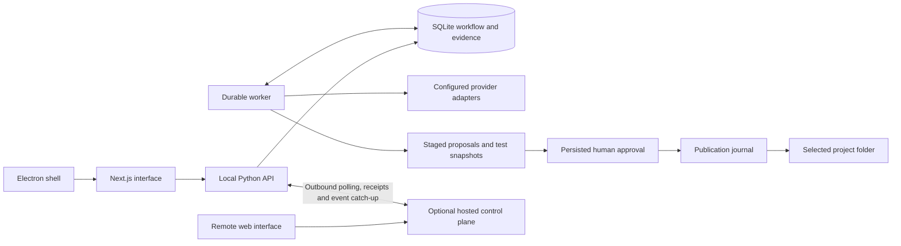
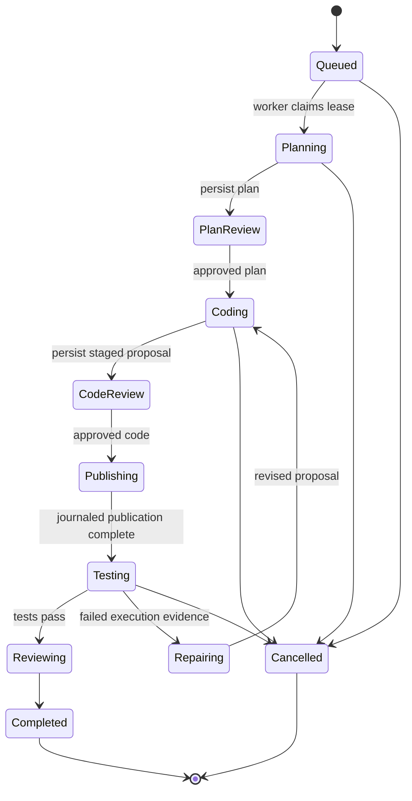
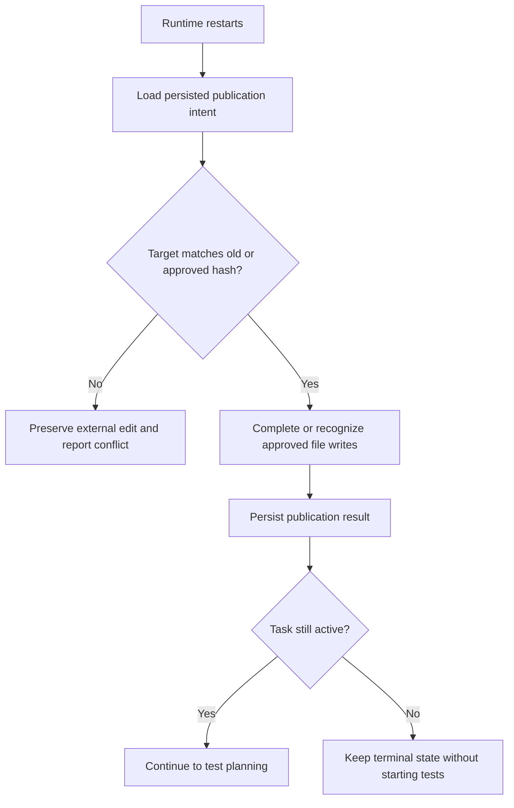

# RLB — Relax Lemme Build

**An AI engineering runtime with durable tasks, human approval gates and recoverable publication.**

RLB coordinates planning, code proposals, test execution, repair and review against a project on the user's machine. A Python worker persists workflow state in SQLite; a Next.js interface exposes tasks and evidence, while an Electron desktop shell packages the local services. An optional hosted control plane carries authenticated commands, review decisions and events to the paired runtime.

The central engineering problem is keeping execution, human decisions and file publication consistent across retries, cancellation, process interruption and disconnected remote control. Model responses are inputs to a persisted workflow; they do not bypass the plan or code approval gates.

[Local development](docs/LOCAL_DEVELOPMENT.md) · [Desktop architecture](docs/DESKTOP.md) · [Recorded verification](docs/V1_VERIFICATION.md)

[Engineering documentation](docs/README.md)

## Runtime and control plane



The selected machine owns project execution. The local development launcher uses embedded workers and SQLite without a cloud account. In desktop mode, the shell manages loopback services, per-launch local authorization and protected paired ownership. The renderer accesses the native bridge through constrained IPC; it does not own the backend's authorization secret.

For hosted control-only deployments, `RLB_CONTROL_PLANE_ONLY=true` prevents hosted worker startup and execution mutations. Existing hosted execution remains a separately configured mode when that setting is false. Remote commands are checked against owner, device and task association, then recorded with durable receipts so redelivery cannot silently repeat an accepted command. An event outbox catches up after network loss using stable cursors. Selected review artifacts can contain project files; remote review is an explicit data boundary, not a claim that source can never leave the machine.

## Durable execution and recovery

The following groups the implemented stages into a readable lifecycle; the worker persists more detailed intermediate states.



The [durable worker](backend/app/services/durable_worker.py) claims runnable work with a lease and renews ownership through heartbeats. Loss of the lease cancels the active work rather than allowing the old worker to continue as owner. Transient retries are bounded; failure, cancellation and interrupted test execution become stored evidence. Startup reconstructs runnable work and persisted review gates instead of treating an in-memory queue as the source of truth.

Plan and code decisions bind to persisted versions. Approval of an earlier proposal cannot authorize a newer one. The workflow separates a staged code artifact from writes to the selected project directory, allowing the user to inspect the exact proposal before publication.

### Journaled file publication

[Local promotion](backend/app/services/local_promotion.py) records immutable approved intent before modifying selected-folder files. It retains the approved content and expected prior hashes, then compares each current file with the expected old or already-published content. A matching file can be written or recognized as complete; a conflicting external edit is preserved and reported.

On restart, the journal completes partial approved publication. Recovery does not resurrect a stopped or failed task into test execution: terminal task state remains terminal. This is recoverable multi-file publication, not a claim that ordinary filesystem writes form a single atomic database transaction.



### Test execution boundary

Tests run in disposable copies of immutable snapshots with bounded output, a minimal environment and process-tree cancellation. Python dependency installation uses a disposable virtual environment. The process driver still has the user's OS permissions: snapshot isolation does not supply a container, a filesystem security boundary or a network firewall.

## Providers and evidence

The [provider interfaces](backend/app/providers/base.py) separate vendor authentication and wire formats from workflow orchestration. Typed requests, responses, streaming chunks, tool calls and token usage flow through adapters and a configured worker/loadout resolver. The returned identity records the executed worker, model, provider and any fallback. Provider credentials are stored encrypted; desktop secret protection and pairing follow the [desktop guide](docs/DESKTOP.md).

The workflow can persist and recover while disconnected from remote control. Model generation still depends on the configured provider and credentials; local execution does not imply universally offline AI inference.

## Run locally

Use Python 3.11+ and Node.js 20.9+; the recorded verification used Python 3.12 on macOS ARM64. From the repository root:

```sh
python3 -m venv backend/.venv
backend/.venv/bin/python -m pip install -r backend/requirements-dev.txt
backend/.venv/bin/python -m backend.local
```

The launcher loads `backend/.env.local` when present, otherwise `backend/.env.example`, and forces the development configuration. It uses SQLite under `storage/local-runtime/rlb.sqlite3` with embedded execution. Inspect health at `http://127.0.0.1:8000/health`. Configure a provider and loadout before requesting AI work.

In another terminal:

```sh
cd frontend
npm ci
NEXT_PUBLIC_API_URL=http://127.0.0.1:8000 npm run dev
```

Real Supabase authentication requires the public Supabase configuration described in [local development](docs/LOCAL_DEVELOPMENT.md). An unconfigured UI can render setup/preview surfaces without fabricating a signed-in session.

For the Electron development shell, install `backend/requirements-desktop.txt` into the backend environment, then run `npm install` and `npm start` from `desktop`. The shell starts the local backend and frontend. Packaged builds use the standalone frontend and frozen Python sidecar; `npm run dist` in `desktop` targets the Windows x64 installer and must run on Windows. Closing the window can leave the app in the tray; use Quit to stop it.

## Verification

[V1 verification](docs/V1_VERIFICATION.md) records **242 backend tests passed and two disposable PostgreSQL tests skipped** on 2026-10-06, plus frontend lint/types/build, nine Electron startup tests and two frontend desktop contract tests. Its 31 V1 cases cover restart at approval gates, failed execution and repair, stale/cross-owner decisions, encrypted configuration reconstruction, terminal publication recovery, external-edit conflicts, cancellation and control-only behavior. These are recorded implementation results, not a fresh run or Windows/hosted acceptance certification.

From a configured development checkout:

```sh
RLB_ENV_FILE=backend/.env.example backend/.venv/bin/python -m pytest backend/tests backend/integration backend/hosted_integration -q --tb=short
backend/.venv/bin/python -m compileall -q backend scripts
```

Run frontend `npm run lint`, `npm run typecheck` and `npm run build` from `frontend`; run `npm run check` and `npm run build:all` from `desktop`. The verification guide specifies the separate Windows installation, PostgreSQL/pgmq and real hosted-account acceptance campaigns. Building a package does not establish those outcomes.

## Code map

| Path | Responsibility |
|---|---|
| [backend/app/services/durable_worker.py](backend/app/services/durable_worker.py) | Leased workflow execution, stage progression and recovery |
| [backend/app/services/local_promotion.py](backend/app/services/local_promotion.py) | Approved-intent journal and conflict-preserving publication |
| [backend/app/providers/](backend/app/providers/) | Provider contracts, adapters, workers and loadout resolution |
| [frontend/](frontend/) | Task, review and configuration interfaces |
| [desktop/](desktop/) | Electron lifecycle, packaging and native bridge |
| [backend/tests/](backend/tests/) · [backend/integration/](backend/integration/) | Unit and workflow regression evidence |

Documentation basis: [`b48e5e9`](https://github.com/akilanpl/RLB-RelaxLemmeBuild-/tree/b48e5e9a60001a7f86fc7dcbf45f47df60b5b942). Historical verification receipts retain their original environment and source scope.
